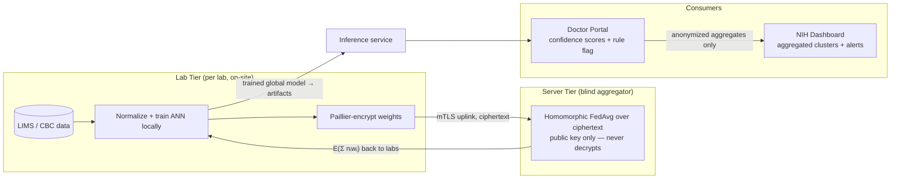

> Current Module 3/4 status: four-class migration. The older full-stack/privacy
> descriptions below are historical design context, not verification of the new
> encrypted path. Module 4 uses plaintext weights and server-authenticated TLS;
> Module 5 migration and Module 9 deployment remain separate.

# FedHealth

**A privacy-preserving federated framework for epidemiological intelligence and blood-disorder prediction.**

FedHealth lets pathology labs collaboratively train a diagnostic model on local
Complete Blood Count (CBC) data **without the raw data ever leaving the lab**. It
gives general practitioners calibrated, real-time diagnostic confidence for
Anemia, Leukemia, and Thalassemia-trait, and gives the National Institute of
Health (NIH) an anonymized, aggregated surveillance view of emerging clusters.

Two hard privacy guarantees hold end to end:

1. **Raw patient data never leaves the lab.** Labs normalize + train locally;
   only model weights are exchanged.
2. **The aggregation server never sees plaintext weights.** Weight updates are
   Paillier-homomorphically encrypted; the server aggregates over ciphertext and
   never holds the private key.

> Final Year Project — Air University Islamabad. This README is the map to the
> whole system, the exact run sequence, and the design decisions to defend.

---

## Architecture

Three tiers, one encrypted data flow:



- **Lab Tier** — a Dockerized Flower client per lab. Wraps the (mock) LIMS,
  normalizes CBC values, trains the ANN locally, encrypts weight updates.
- **Server Tier** — a Flower server that aggregates the encrypted updates with
  FedAvg. It holds only the Paillier **public** key, so it is mathematically
  blind to the weights.
- **Doctor Portal** — CBC entry / OCR / multilingual symptoms → calibrated
  per-condition confidence + the thalassemia-trait rule flag → doctor confirms.
- **NIH Dashboard** — Leaflet map of aggregated clusters, a predictive-alert
  feed, and immutable-audit compliance oversight.

---

## Where each scope module lives

| Scope module | Implementation |
|---|---|
| 6.1 RBAC / MFA / audit | `backend/src/auth`, `backend/src/middleware`, `db/schema.sql` |
| 6.2 Doctor Portal (OCR, NLP, scoring, trends) | `frontend/src/doctor`, `backend/src/services/{ocr,nlp}`, `ml/inference_service` |
| 6.3 Lab Tier (LIMS wrapper, local training) | `fl/client`, `ml/fedhealth_ml` |
| 6.4 Server Tier (HE uplink, FedAvg) | `fl/server`, `fl/common/crypto.py`, `ml/fedhealth_ml/paillier_utils.py` |
| 6.5 NIH Dashboard (geospatial, alerting) | `frontend/src/nih`, `backend/src/routes/nih.js`, `backend/src/services/alerting.js` |
| 6.6 End-to-end encrypted flow | `fl/`, `docker-compose.yml` |

---

## Repo layout

```
fedhealth/
├── docker-compose.yml        # whole stack in one command
├── .env.example              # compose environment
├── db/                       # PostgreSQL: schema, seed, migrations
├── backend/                  # Node/Express API (auth, RBAC, audit, domain)
├── ml/
│   ├── fedhealth_ml/         # shared: schema, preprocess, models, rules, paillier
│   ├── notebooks/            # Colab: EDA, preprocess, train Model A / Model B
│   └── inference_service/    # Python/Flask model-serving microservice
├── fl/                       # Flower federated learning
│   ├── common/               # partition, task, crypto bridge
│   ├── client/               # Lab Tier client (+ Paillier variant)
│   ├── server/               # Server Tier strategy (+ blind Paillier strategy)
│   ├── keygen.py             # Paillier keypair (private key → labs only)
│   └── run_simulation*.py    # one-command federation (plaintext / encrypted)
├── frontend/                 # React (Vite): Doctor Portal + NIH Dashboard
└── models/                   # drop Colab-trained artifacts here
```

Each folder has its own README with deeper detail (`db/`, `backend/`, `ml/`,
`ml/inference_service/`, `fl/`, `frontend/`).

---

## Prerequisites

- **Docker + Docker Compose** (the simplest path), or Node 18+, Python 3.11+,
  and a PostGIS-enabled PostgreSQL 16 for a manual run.
- The **three CSV datasets at the repo root**
  (historical inputs `anemia_diagnosed_cbc_data_v4.csv`, `thalassemia_alphanorm.csv`,
  `biased_leukemia_dataset.csv`) — the inference/FL images copy them in.
- For the **real** federated model: a Google Colab run of the notebooks
  (produces the artifacts in `models/`). Until then the system serves a clearly
  labelled fallback so the whole stack is demoable immediately.

---

## Run it — the whole stack (Docker)

```bash
cp .env.example .env          # set JWT_SECRET at minimum
docker compose up --build
```
- Frontend  → http://localhost:8080
- Backend   → http://localhost:4000
- Inference → http://localhost:8000

Create the first admin (in another terminal):
```bash
docker compose exec backend npm run bootstrap:admin -- \
  admin@fedhealth.pk 'StrongPass123' 'FedHealth Admin'
```
Then open the frontend, sign in, and complete MFA setup (scan the QR).

### The federation demo (optional, batch job)
```bash
docker compose --profile federation up --build   # Flower server + 3 lab clients
```
For the **blind-server encrypted** federation (proves the second guarantee) run
the one-command simulation locally:
```bash
pip install -r fl/requirements.txt
python fl/run_simulation_paillier.py --labs 3 --rounds 3 --bits 1024
```

---

## Current four-class training and inference

Use the four staged notebooks in `Module 3 ML`: `01_eda`, `02_preprocess`,
`03_train_centralized`, `04_federated`. Their README gives executable commands.
The ten-feature model predicts healthy/anemia/thalassemia/leukemia confidence
scores. ANN weights are federated; XGBoost is a local head, refit centrally for
Colab reference comparisons. The earlier nine-class/carrier notebooks are archived.
No old performance figure applies to this dataset. Rules are research-only and
not active clinical flags. Missing trained artifacts do not activate a fallback.

Preserve complete selected artifact bundles, including manifest/reload markers,
and register measured final metrics under the exact saved version. See
`docs/FOUR_CLASS_SCOPE_RECONCILIATION.md` and `docs/VERIFICATION.md` for current
architecture boundaries, dataset caveats and checks actually performed.

---

## How the privacy guarantees are enforced (defense summary)

- **Raw data never leaves the lab.** The Flower client reads the local shard via
  the (mock) LIMS, normalizes + trains in-process, and returns only weights.
- **Server is blind.** Labs encrypt weights with the Paillier **public** key; the
  server computes `E(Σ nᵢ·wᵢ)` with homomorphic add + scalar-multiply and returns
  it; the labs (holding the **private** key) decrypt and divide by `N`. Verified:
  encrypted FedAvg reproduces plaintext FedAvg to ~1e-7, server never decrypts.
- **NIH sees only aggregates.** The `nih_prediction_clusters` view exposes
  district-level counts + average confidence — no `patient_ref`, no raw CBC — and
  the NIH role lacks `report:read` / `prediction:read` in RBAC.
- **Tamper-evident audit.** `audit_logs` is hash-chained and append-only
  (triggers + `REVOKE`); `verify_audit_chain()` detects any edit, surfaced in the
  Compliance view.
- **Pseudonymous patients.** `patient_ref` is an opaque token; no name/ID is
  stored centrally.

---

## Documented simplifications (for the supervisor)

These are deliberate FYP-scope calls, each flagged where it was made:

- **Data:** the `biased_leukemia_dataset.csv` has no predictive signal and no
  Pakistani data → excluded from modelling, kept as an EDA/fairness case study;
  leukemia signal comes from the anemia CBC rows instead. Thalassemia pivoted
  from (CBC-invisible) alpha carriers to (CBC-detectable) **beta-thal trait**.
- **Federation:** all labs share one preprocessor (summary statistics, not
  patient data) as an agreed normalization standard. The **ANN** is federated;
  **XGBoost** is a local meta-head (trees aren't weight-averageable).
- **Crypto:** labs share one Paillier keypair; production would use **threshold
  Paillier** so no single party holds the key. Demo uses 1024-bit keys (2048+ for
  real security).
- **Transport:** server-authenticated **TLS**; full client-certificate **mTLS**
  is a hardening step.
- **Auth:** **bcryptjs** (pure-JS) instead of argon2 to avoid native-build
  friction; MFA is mandatory via token scopes.
- **Serving:** the inference service is **Flask**; a sklearn **fallback** serves
  until the Colab artifacts are present. Symptoms are decision-support **context**
  (not model input); the multilingual NLP is a keyword lexicon (no external
  translation API).
- **Frontend:** token in `localStorage` (httpOnly cookie = hardening); voice via
  the Web Speech API (progressive enhancement); `recharts` + `react-leaflet` are
  additions within the React/Leaflet stack.
- **Compose:** the encrypted federation is demonstrated via the one-command
  simulation; the compose `federation` profile runs the plaintext FedAvg variant.

---

## Tech stack

React · Node.js/Express · Flower (`flwr`) · Python · Paillier (`phe`) ·
Tesseract OCR · Leaflet.js · PostgreSQL/PostGIS · TensorFlow + XGBoost (models).

## Team

Muhammad Ahsan (231586) · Muhammad Usman Iqbal (231580) · Muhammad Annas (231631)
· Supervisor: Sir Sagheer Ahmed · Co-supervisor: Ms Nazish Yousaf.
